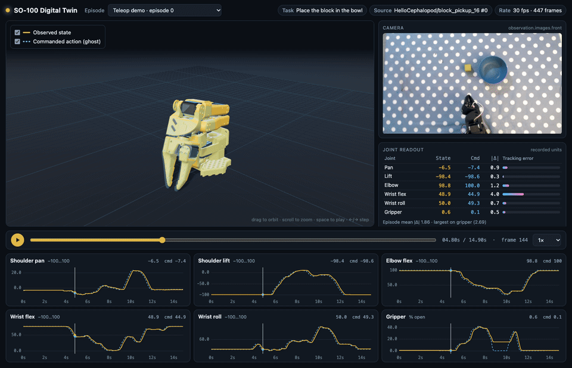
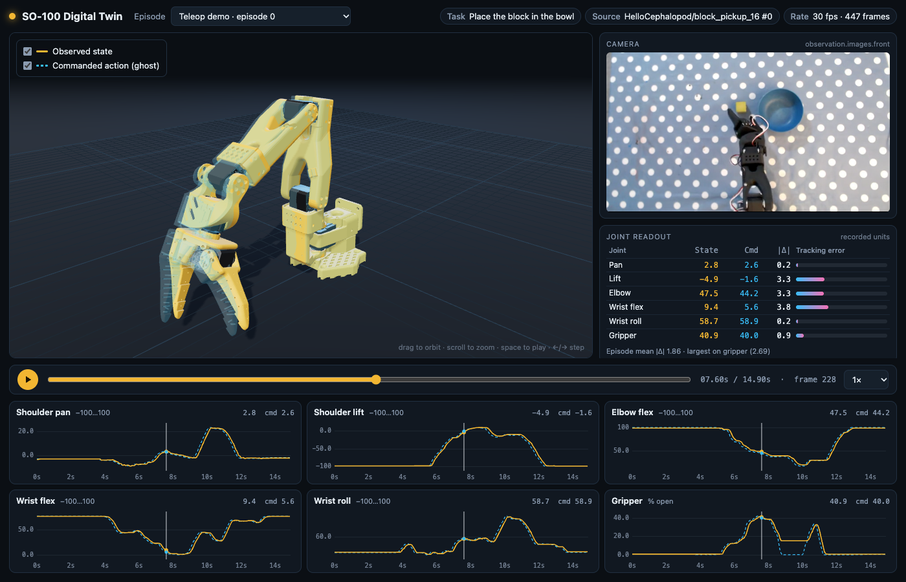
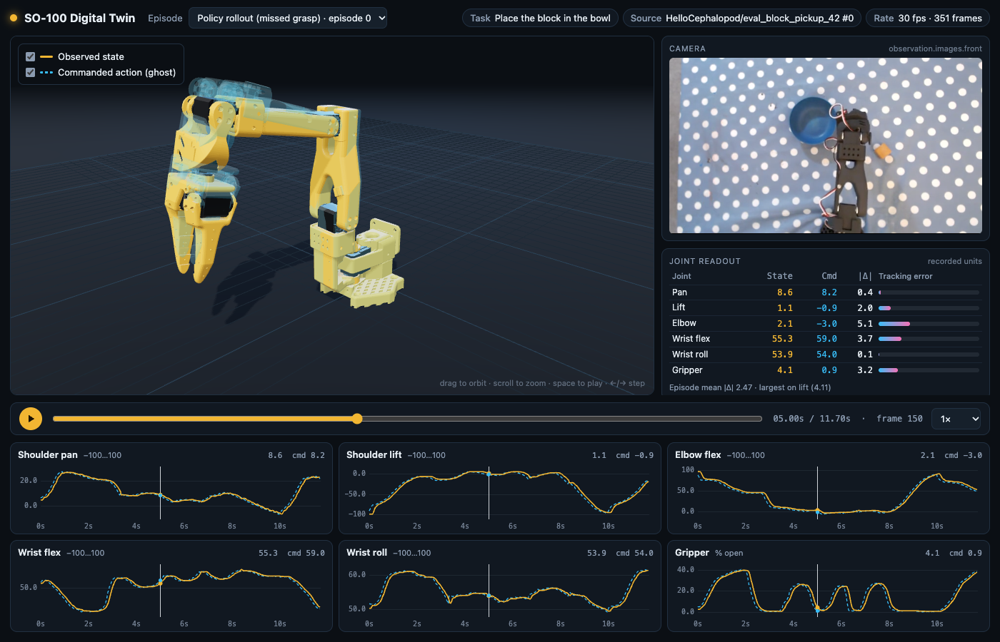

# SO-100 Digital Twin

A browser digital twin for the [SO-100 arm](https://github.com/TheRobotStudio/SO-ARM100). It replays
[LeRobot](https://github.com/huggingface/lerobot) episodes on a 3D URDF model, with the recorded
camera video and a joint-angle plot for each joint, all synced to one timeline.



The **solid arm** shows the observed follower state (`observation.state`). The **translucent blue
ghost** shows the commanded `action`: the leader arm during teleoperation, or the policy output
during an eval rollout. When the two separate, you are looking at tracking lag, a blocked gripper,
or a policy asking for something the follower can't do.

| Teleoperation demo | Policy rollout (missed grasp) |
| --- | --- |
|  |  |

In the teleop episode, look at the gripper plot around 9–11 s. The command (dashed blue) drops to
0 % while the observed jaw stays at about 15 %. That gap is the block sitting between the jaws.

## Features

- **URDF arm** (three.js + [`urdf-loader`](https://github.com/gkjohnson/urdf-loaders)) with an orbit
  camera, soft shadows, a ground grid and a dark theme
- **State vs. action** shown as a solid arm and a ghost arm. Each can be toggled.
- **Transport**: play/pause, scrubbing, 0.25×–2× speed, `space` to play, `←/→` to step one frame
  (hold `shift` for 10 frames)
- **Synced plots**: one canvas chart per joint with the playhead. Click or drag a chart to seek.
- **Camera frames** drawn by index from the playback clock, so the footage stays locked to the arm in every browser
- **Joint readout** of state, command and |Δ| per joint at the playhead, plus the mean tracking
  error for the whole episode
- **Small footprint**: the only runtime dependencies are `three` and `urdf-loader`. The plots are
  plain canvas code, so there is no chart library.

## Quick start

```bash
npm install
npm run dev          # http://localhost:5173
```

The repo ships with two sample episodes (see [Data](#data)), so the viewer runs without any other
setup. `npm run build` type-checks with `tsc` and then builds a static site into `dist/`. The build
uses relative paths, so any static host works.

URL parameters are handy for sharing a specific moment:

| Param | Example | Effect |
| --- | --- | --- |
| `ep` | `?ep=policy-rollout-ep0` | pick an episode |
| `t` | `&t=7.5` | start at 7.5 s |
| `paused` | `&paused` | don't autoplay |
| `action=0` | `&action=0` | hide the ghost arm |
| `view` | `&view=top` / `side` / `front` / `px,py,pz,tx,ty,tz` | camera preset |

## Converting your own LeRobot data

`tools/convert_lerobot.py` reads a local LeRobot v2.x dataset (`meta/info.json`,
`data/chunk-*/episode_*.parquet` and `videos/`) without modifying it. It writes one compact JSON file
per episode, an H.264 re-encode of one camera stream, and a 480 px JPEG sequence extracted from it
(what the viewer shows), then merges the new episodes into
`public/episodes/index.json`.

```bash
uv run tools/convert_lerobot.py \
  --dataset ~/.cache/huggingface/lerobot/<hf-user>/<dataset> \
  --episodes 0 1 2 \
  --calibration ~/.cache/huggingface/lerobot/calibration/robots/so100_follower/<robot.id>.json \
  --out public/episodes \
  --label "Block pickup"
```

The script declares its dependencies (`pyarrow` and `numpy`) inline, so `uv run` needs no
virtualenv. Video needs `ffmpeg` on your `PATH`. AV1 sources decode with `libdav1d`. Pass
`--no-video` to skip video, `--camera observation.images.wrist` to pick a different stream, and
`--video-width` to trade size for sharpness.

Use the calibration file for the same `--robot.id` you recorded with. Newer LeRobot datasets store
**normalized** values, and the arm's calibration is needed to turn them back into angles. Without
`--calibration` the script falls back to a generic ±100° range, and the 3D pose will only be roughly
right.

## Joint mapping

This is the part to review if the twin doesn't match your arm.

### Units in the dataset

| Dataset flavour | Detected by | Stored values |
| --- | --- | --- |
| LeRobot ≥ 0.2 (`robot_type: so100_follower`) | names like `shoulder_pan.pos` | Body joints are `RANGE_M100_100`: −100…100 across the calibrated `[range_min, range_max]` in servo ticks. The gripper is `RANGE_0_100`, from 0 = closed to 100 = open. |
| Legacy LeRobot (`robot_type: so100`) | names like `main_shoulder_pan` | Degrees, with 0 at the old "arm fully extended horizontally" calibration pose |

The plots and the readout show these values unchanged, in the units the dataset uses. Only the 3D
model uses converted angles.

### Dataset → URDF (radians)

For normalized datasets, the converter first recovers the raw servo position (the STS3215 has 4096
ticks per turn, and LeRobot's calibration pose reads 2047):

```
raw = range_min + (v + 100) / 200 · (range_max − range_min)     # body joints
raw = range_min + v / 100 · (range_max − range_min)             # gripper
q   = sign · (raw − ref) · 2π / 4096 + offset
```

The all-zeros pose of the SO-100 URDF is the folded **rest** pose, with the upper arm back on its
stop and the forearm folded over it. That sets the reference point for each joint:

| LeRobot joint | URDF joint | sign | ref (URDF zero) | How it was checked |
| --- | --- | --- | --- | --- |
| `shoulder_pan` | `shoulder_pan` | −1 | 2047 (calibration pose) | Overhead video: +pan swings toward the bowl on the robot's right |
| `shoulder_lift` | `shoulder_lift` | +1 | `range_min` (rest stop) | Rest and reach poses match the video |
| `elbow_flex` | `elbow_flex` | +1 | `range_max` (fully folded) | Rest and reach poses match the video |
| `wrist_flex` | `wrist_flex` | +1 | 2047 | The sign was flipped after comparing with the video: at rest the gripper tucks down, and lower values lift it forward |
| `wrist_roll` | `wrist_roll` | +1 | 2047 | Jaw orientation looks right from overhead. **Approximate.** |
| `gripper` | `gripper` (moving jaw) | +1 | `range_min` (closed) | 0 % = closed. The opening angle scales with the calibrated span. **Approximate.** |

The legacy degree format uses `q = sign · deg + offset`. Its values are: pan −1 / 0°,
lift −1 / +180°, elbow +1 / −180°, wrist flex +1 / 0°, wrist roll +1 / 0°, gripper +1 / 0°.

### Caveats

- **The mapping was fitted to one arm.** The signs and references were set by comparing the model
  with overhead video of my own SO-100 follower (calibration `black.json`). They should hold for
  standard SO-100 builds on the default LeRobot calibration flow. A different horn position or
  `drive_mode` could flip a sign. All of the constants are in `NORMALIZED_MAP` / `LEGACY_MAP` at the
  top of the converter.
- **`range_min`/`range_max` stand in for the URDF zero** on the lift and elbow joints. If your
  calibration sweep didn't reach the physical rest stops, the whole arm will be offset by a few
  degrees.
- **The legacy (degrees) mapping has not been checked against video.** It lines up with the
  normalized mapping on the rest pose (lift and elbow come out within about 7° of zero, and the
  wrist-flex magnitude matches), but the pan and roll directions are assumed.
- **Action goes through the follower calibration.** During teleop, LeRobot normalizes the leader
  arm with the leader's calibration and sends that normalized goal to the follower. Mapping it
  through the follower calibration therefore shows what the follower was *asked* to do, which is
  the useful comparison here.
- **The URDF is an approximate model.** The meshes, link lengths and joint limits are TheRobotStudio's.
  Nothing here was measured again.

## Data

The two sample episodes in `public/episodes/` (about 0.8 MB in total) are my own recordings, made with
my self-built SO-100 leader/follower pair and LeRobot:

| Sample | Source dataset | Notes |
| --- | --- | --- |
| `teleop-block-pickup-ep0` | `HelloCephalopod/block_pickup_16`, episode 0 | Teleoperated demo, "Place the block in the bowl", 30 fps, 447 frames |
| `policy-rollout-ep0` | `HelloCephalopod/eval_block_pickup_42`, episode 0 | A policy eval rollout on the same task. It reaches but misses the grasp. |

The footage is `observation.images.front` (overhead), re-encoded to 640 px H.264 and extracted to 480 px JPEG frames. I release the
sample data under CC BY 4.0, the same terms LeRobot's community datasets usually use.

## Project layout

```
index.html                 app shell
src/main.ts                playback clock, UI wiring, URL params
src/camera.ts              camera pane: JPEG frames drawn by index on a canvas
src/scene.ts               three.js scene, lights, floor, URDF loading, solid + ghost arms
src/plots.ts               per-joint canvas charts with playhead + click-to-seek
src/readout.ts             state / command / tracking-error table
src/episode.ts             episode JSON types, time→frame lookup, interpolation
tools/convert_lerobot.py   LeRobot dataset → episode JSON + H.264 video + JPEG frames
tools/capture.mjs          headless-Chrome screenshots / GIF via CDP (no npm deps)
public/urdf/so100/         SO-100 URDF + STL meshes (Apache-2.0, TheRobotStudio)
public/episodes/           sample episodes + index.json
```

### Regenerating the screenshots

```bash
npm run build && npx vite preview --port 4173 &
node tools/capture.mjs shot "http://localhost:4173/?ep=teleop-block-pickup-ep0" 7.6 docs/screenshot-teleop.png
GIF_WIDTH=960 node tools/capture.mjs gif "http://localhost:4173/?ep=teleop-block-pickup-ep0" docs/demo.gif 8 4.8 12.8
```

Headless Chrome renders WebGL through SwiftShader (`--use-angle=swiftshader`), so no GPU is needed.
Rendering in software takes a few seconds per frame. The images in `docs/` are real captures of the
running app.

## Credits

- **SO-ARM100 / SO-100** by [The Robot Studio](https://github.com/TheRobotStudio/SO-ARM100). The URDF
  and meshes in `public/urdf/so100/` come from that repo unmodified, under Apache-2.0. See
  `public/urdf/so100/NOTICE.md`.
- **[LeRobot](https://github.com/huggingface/lerobot)** by Hugging Face (Apache-2.0), for the
  recording, dataset format and calibration conventions this viewer reads.
- **[urdf-loader](https://github.com/gkjohnson/urdf-loaders)** by Garrett Johnson (Apache-2.0) and
  **[three.js](https://threejs.org)** (MIT).

## License

The code is MIT © 2026 Matthew Waller (see `LICENSE`). Third-party assets keep their own licenses:
the SO-100 URDF and meshes are Apache-2.0. The sample episode data is CC BY 4.0, © Matthew Waller.
